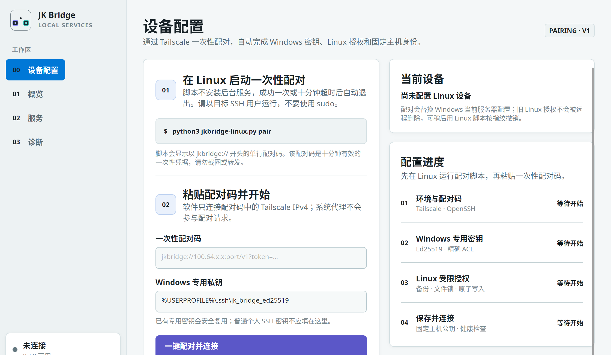

<p align="right"><a href="README.md">English</a> · <strong>简体中文</strong></p>

<p align="center">
  
</p>

<h1 align="center">JK Bridge</h1>

<p align="center">
  通过 Tailscale 和受严格限制的 OpenSSH 隧道，在 Windows 打开 Linux 本机网页。<br>
  不再固定 Tailscale IP，不再手工编辑 SSH 公钥，也不需要 Linux 后台程序。
</p>

<p align="center">
  <a href="https://github.com/Mathjk/jk-bridge/actions/workflows/ci.yml"></a>
  <a href="https://github.com/Mathjk/jk-bridge/releases/latest"></a>
  <a href="LICENSE"></a>
  
</p>

<p align="center">
  <a href="https://github.com/Mathjk/jk-bridge/releases/latest"><strong>下载最新版</strong></a> ·
  <a href="#五分钟首次配置"><strong>快速开始</strong></a> ·
  <a href="docs/INSTALLATION.zh-CN.md"><strong>安装指南</strong></a> ·
  <a href="docs/TROUBLESHOOTING.zh-CN.md"><strong>故障排查</strong></a> ·
  <a href="docs/SECURITY.md"><strong>安全设计</strong></a>
</p>

<p align="center">
  
</p>

> [!NOTE]
> 最新稳定版是 **v2.2.0**，同时提供未签名的当前用户 Windows 安装器和经过
> 校验的便携 ZIP。本版加入 Windows 本机服务发现、更清楚的服务编辑、非秘密
> Service Profile、可见的两阶段更新、外观修复、分类导航和首次启动教程。
> 推荐的 Linux 安装与恢复方式仍是一次性的 `jkbridge-linux.py`。可选的无 AI
> Linux Agent 与受控中继生命周期仍属于高级/实验功能，正常使用不需要安装。

## 为什么需要 JK Bridge？

Overleaf、GPU 监控、Jupyter 等自建网页只监听 Linux `127.0.0.1` 时更安全，但 Windows 电脑无法直接打开。JK Bridge 把它们转换成普通的 Windows 本机网址，同时保留两端的回环边界。

软件保存 Linux 节点稳定的 Tailscale MagicDNS 名称，而不是容易变化的 `100.x.y.z` 地址；全部已启用服务由同一个受监管的 SSH 隧道承载。

```text
Windows 浏览器                                                   Linux 主机
http://127.0.0.1:8080/project                                    127.0.0.1:80
          │                                                             ▲
          └── JK Bridge ── OpenSSH 本地转发 ── Tailscale ────────────────┘
```

首次使用只需：在 Linux 启动临时脚本，把一次性配对码粘贴到 Windows 软件，再点击“配对并连接”。配对成功后 Linux 脚本自动退出；以后日常使用只需启动 `JKBridge.exe`。

## 哪个文件在哪台设备运行？

| 文件或组件 | 运行位置 | 用途 |
|---|---|---|
| `JKBridge.exe` | Windows 11 x64 | 桌面界面、首次配置、隧道监管、健康检查、托盘和开机启动 |
| `jkbridge-linux.py` | Linux | 一次性配对、查看托管 SSH 密钥和撤销授权 |
| Tailscale | 两台设备 | 加密设备网络和稳定的 MagicDNS 身份 |
| OpenSSH Client | 仅 Windows | 创建专用密钥并运行本地转发隧道 |
| OpenSSH Server | 仅 Linux | 接收受限公钥并终止隧道 |

> [!IMPORTANT]
> Windows **不需要** OpenSSH Server；Linux **不需要**安装 JK Bridge 桌面软件。

## 环境要求与官方下载

| 设备 | 要求 | 官方安装或下载 | 快速验证 |
|---|---|---|---|
| Windows | Windows 11 x64 | 系统自带 | `winver` |
| Windows | Tailscale 已安装、运行并登录 | [Windows 下载](https://tailscale.com/download/windows) · [安装说明](https://tailscale.com/docs/install/windows) | `tailscale status` |
| Windows | OpenSSH Client（`ssh.exe` 和 `ssh-keygen.exe`） | [微软安装说明](https://learn.microsoft.com/en-us/windows-server/administration/openssh/openssh_install_firstuse) | `Get-Command ssh, ssh-keygen` |
| Linux | Tailscale 已安装、运行并登录 | [Linux 安装说明](https://tailscale.com/docs/install/linux) · [手动软件包](https://pkgs.tailscale.com/stable/) | `tailscale status` |
| Linux | Python 3.9 或更高版本 | 发行版软件包，或 [python.org](https://www.python.org/downloads/) | `python3 --version` |
| Linux | OpenSSH Server，且有 Ed25519 主机密钥 | [Ubuntu Server 官方说明](https://documentation.ubuntu.com/server/how-to/security/openssh-server/) | `sudo sshd -t` |
| Linux | 目标网页监听在回环地址 | 对应网页服务的说明 | `curl -I http://127.0.0.1:<端口>/` |

两台设备必须出现在同一个 tailnet 中，或者 tailnet 访问策略已经明确允许两者通信。登录邮箱可以不同，真正需要一致的是 tailnet 成员关系。

JK Bridge 会检查这些依赖，但不会自行提权安装系统软件、修改软件源或 `sshd_config`，也不会启动 Overleaf、GPU Dashboard 等网页服务。图形界面和命令行两种安装方式见[分步安装指南](docs/INSTALLATION.zh-CN.md)。

## 五分钟首次配置

### 1. 安装并检查基础环境

在两台设备上完成上表。Windows 安装的是 **OpenSSH Client**，不是 OpenSSH Server；Linux 则要确认 SSH Server 和目标网页已经启动。

### 2. 在 Windows 下载并校验 JK Bridge

从[最新版 Release](https://github.com/Mathjk/jk-bridge/releases/latest)下载同一版本的两个文件：

- `JKBridge-win-x64.zip`
- `JKBridge-win-x64.zip.sha256`

在下载目录打开 PowerShell：

```powershell
Get-FileHash .\JKBridge-win-x64.zip -Algorithm SHA256
Get-Content .\JKBridge-win-x64.zip.sha256
```

两处哈希必须完全一致，然后把 ZIP 解压到一个长期保留的目录。当前发布程序还没有商业代码签名，Windows 可能显示“未知发布者”；确认哈希无误后再决定运行。

### 3. 在 Linux 启动快速配对

在 Windows 软件中打开“设备配置”，点击“复制一行配对命令”。把命令粘贴到
Linux 终端，并用以后用于 SSH 的普通用户运行，不要加 `sudo`。Linux 只需要
Python 3，不需要克隆项目、手动下载脚本、进入目录或执行 `cd`。

这条命令已经包含 Windows 版本内嵌的压缩助手，并在执行 `pair` 前核验固定
SHA-256；Linux 不需要访问外网。保持终端不关闭；脚本会显示一个以
`jkbridge://` 开头的配对码，它在 10 分钟后失效，并且只能成功使用一次。

如果已经手动复制过脚本，传统恢复方式仍然可用：

```bash
chmod 700 ~/jkbridge-linux.py
python3 ~/jkbridge-linux.py status
python3 ~/jkbridge-linux.py pair
```

### 4. 在 Windows 完成配对

1. 启动 `JKBridge.exe`；
2. 如果没有自动显示，就打开“设备配置”；
3. 粘贴完整的 `jkbridge://...` 配对码；
4. 点击“配对并连接”。

软件会创建专用 Ed25519 密钥、收紧 Windows 文件权限、固定 Linux SSH 主机密钥，并让 Linux 脚本写入一条仅允许指定回环端口的授权。整个过程不需要输入 Linux 密码，也不会传输私钥。

### 5. 打开网页服务

在“概览”页或系统托盘点击服务。浏览器地址仍然是 Windows 本机网址，例如 `http://127.0.0.1:8080/project`；不要换成 Linux 的 Tailscale IP。

默认示例：

| 服务 | Windows 打开地址 | Linux 转发目标 |
|---|---|---|
| Overleaf | `http://127.0.0.1:8080/project` | `127.0.0.1:80` |
| GPU Dashboard | `http://127.0.0.1:8765/` | `127.0.0.1:8765` |
| Investment News | `http://127.0.0.1:8793/` | `127.0.0.1:8793` |

这些条目都可以编辑。JK Bridge 不会把它们绑定到公网或普通局域网。

每个服务的 SSH 转发、浏览器地址、健康检查和 Linux 授权端口都由同一条回环路由生成。对于自签名 HTTPS，可在“服务”页选择“TCP 端口”健康检查；健康警告仍会显示，但只要 SSH 转发已经建立，就不会阻止浏览器打开。

### 扫描这台 Windows 上的本机网页

在“服务 → Windows 本机”点击“扫描本机”。JK Bridge 只读取 Windows
当前已经处于监听状态的 `127.0.0.1` 和 `::1` TCP 端口，然后对这些候选
端口发送短时、无正文的 HTTP/HTTPS `HEAD` 请求：

- 不扫描任何磁盘，也不遍历 `1–65535` 端口；
- 不使用系统代理、不携带 Cookie、不跟随跳转、不读取页面正文；
- 总扫描设有 8 秒上限，单次探测也有短超时和并发上限；
- 已属于 JK Bridge Linux 隧道的端口只标记，不重复保存；
- “仅 TCP”表示端口有程序监听，但尚不能认定它是网页；
- 自签名 HTTPS 可以被识别，但会标明证书未验证；保存时默认使用 TCP
  状态判断。

确认是网页的结果可以保存为独立的 Windows 本机服务。它们不会加入 SSH
转发或 Linux 端口授权，保存、删除也不会启动、停止对应的 Windows 程序。
进程名仅用于显示和变化提醒，不作为身份或授权依据。未启动的潜在服务无法仅靠
监听表可靠发现；已经保存的条目仍会保留，并在下次扫描时显示“离线”或恢复可用。

### 理解 Windows 端口和 Linux 端口

两端端口不必相同。例如 JK Bridge 只在 Windows 回环端口 `8080` 上监听，
然后把流量转发到 Linux 回环端口 `80`：

```text
浏览器打开 http://127.0.0.1:8080/project
              Windows localPort 8080
                       -> Linux remotePort 80
```

浏览器网址永远使用 **Windows 本地端口**。协议和路径可以按服务选择，例如
`https` 与 `/login`，但主机仍必须严格是 `127.0.0.1`。JK Bridge 只做 TCP
转发，不会改写网页应用返回的重定向，也不会让签发给其他域名的证书自动适用于
`127.0.0.1`。

在稳定版 v2.2.0 中，应在“服务”页一起核对 Windows 端口、Linux 目标端口和
回环网址。简单模式会根据“协议 + Windows 端口 + 打开路径”自动生成网址并
预览完整映射；高级模式仍可填写经过校验的自定义回环网址。

## 首次配置完成以后

| 情况 | 需要做什么 |
|---|---|
| Windows 正常重启 | 双击 `JKBridge.exe`；或者提前打开一次“随 Windows 启动” |
| Linux 的 Tailscale IP 改变 | 什么都不用做；软件会解析保存的 MagicDNS 身份 |
| 新网页使用已经授权过的 Linux 端口 | 在“服务”页添加或编辑即可 |
| 新网页需要新的 Linux 目标端口 | 先启用服务，再在 Linux 运行 `pair`，使用原 Windows 密钥重新配对 |
| Linux 重装或主动轮换 SSH 主机密钥 | 在 Linux 本机确认变更，然后重新配对 |
| Windows 设备或私钥丢失 | Linux 运行 `status`，再运行 `remove --fingerprint 'SHA256:...'` |
| 从 v2.0.x 升级到 v2.1 | 启动新版后按提示重新配对一次，以建立可核验的端口授权记录 |

重新配对只更新 `~/.ssh/authorized_keys` 中 JK Bridge 自己管理的那一行，并会先备份到 `~/.ssh/jkbridge-backups/`。

## v2.2.0 迁移与可选实验性 Agent 状态

预期的 Agent 优先新设备流程是：Linux 一次性安装 Agent 后，在新电脑完成“登录
Tailscale → 安装 JK Bridge → 添加此电脑 → 同步服务 → 连接”。可选的
`jkbridge-agent` 应当是普通、确定性的 Linux 程序，完全不依赖 AI、模型
API、Codex 或云端运行时。SSH 仍是受限的数据通道；每台 Windows 都有独立
密钥，可以单独撤销而不影响其他电脑。

这套可选的 Agent 优先流程 **不是 v2.2.0 的默认受支持路径**：

- 源码中已有开发版 Linux Agent、加固的用户级 unit/环境文件、打包检查和已
  配套的回环中继助手，以及已接线的 Windows 登记/管理客户端。一组已部署设备
  已完成非 root 安装/初始化/启动/重启/状态检查、明确发现 Agent、首台管理员
  登记、服务清单同步、精确 SSH 授权与建链；带清单验证的升级、回滚、保留状态
  的卸载、第二台设备撤销和自动化测试已实现，干净机器现场验收与稳定发布签核
  仍待完成；
- 当前源码版把 Agent 初装收敛成两步：从 Windows 复制一条自包含命令，在普通
  Linux 用户的终端执行，再把输出的 `JKBA1.` 配置码粘贴回 Windows。不需要
  克隆仓库、进入下载目录或执行 `cd`。对已受管 Agent 重复执行同一命令就是
  保留身份的升级，Windows 无需重新粘贴配置码。Python 3.9+、Tailscale、
  OpenSSH Server、`socat`、`ss` 与 systemd 用户管理器仍是明确的系统前置
  条件，命令不会通过 sudo 自动安装系统软件；
- 任意已登记的 Agent 设备都可以通过认证 `/v1/me` 与 `/v1/services` 手动
  同步自己的服务选择；管理员还可以查看全部设备，并在明确确认后撤销所选的
  非当前设备，也可以在 Windows 管理界面生成 10 分钟有效、仅用一次、只能
  登记普通设备的添加码。第一台管理员设备仍使用 Linux 初始化/恢复时打印的
  一次性凭据，现在它会和已验证地址一起封装在 `JKBA1.` 配置码中；
- 源码已有有界、只读的 Agent 发现引擎：只检查 Tailscale 当前已知的在线 peer
  的 `45871` 端口，并核对节点 ID、MagicDNS、tailnet、协议与 Agent 版本。
  v2.2.0 的设备配置页只在用户于高级区域明确点击“发现 Agent”后调用它。单个结果只会
  预选而不会直接采用；多个结果必须手选，并且总要另外点击“使用所选地址”。
  发现本身绝不会登记设备，仍须提供一次性代码并明确点击登记。该 GUI 尚未完成
  干净 Windows 验收。

当前源码版的“服务”页还增加了仅管理员可用的“Linux 待添加服务”收件箱。
用户明确点击扫描后，Agent 只读取当前精确的 `127.0.0.1` TCP 监听，并进行
有界的回环元数据探测；不会扫描磁盘或端口范围。用户也可以直接粘贴严格的
`http(s)://127.0.0.1:端口/路径` 或 `localhost` 地址。两条路径都只创建
停用的 Windows 草稿；粘贴地址中的查询参数与片段会被删除，Linux 清单和 SSH
授权保持不变，直到用户查看现有差异预览并明确确认。识别模板包括 Syncthing、
JupyterLab、Grafana、Ollama、ComfyUI、Stable Diffusion WebUI、Overleaf、
Sub2API，并保留通用兜底模板。

“诊断”页现在提供四层“连接医生”：依次定位 Tailscale/对端、SSH 信任与授权、
隧道、服务健康，并显示具体原因、下一步建议和对应的重试/配置/服务按钮。

v2.2.0 的可选实验性 Agent 还实现了仅管理员可用的“Linux 可达目标”流程：先生成只读计划
并从 Linux 探测目标，展示规范化映射和受影响授权，再要求单独勾选确认，才允许
创建、更新或删除。应用当前计划时，Agent 使用同包的 `jkbridge_relay.py`、
`/usr/bin/socat` 和用户级 systemd unit，只在 Linux
`127.0.0.1:<relayPort>` 监听，并以事务方式更新服务清单与精确 `permitopen`
授权。它只转发一个明确主机与端口，不是 SOCKS 或通用代理。首轮现场登记期间，
既有的人工回环中继保持在线；但 Windows 端管理的创建/更新/删除和干净机器验收
仍待完成。

上述发布门槛完成前，每台新 Windows 仍使用一次性助手配对。不要在电脑之间
复制私钥、授权回执或整个 `config.json`。v2.2.0 Service Profile 界面只迁移
非秘密服务选择，导入本身绝不会取得 Linux 授权。作为迁移后备，v2.2.0
导入器也能严格验证一份 v2.1/schema v3 `config.json`，再只把其中 Services
投影到同一预览；旧设备、服务器、密钥路径、tailnet、行为设置和授权字段全部
丢弃。不要用旧文件覆盖新电脑配置；能导出非秘密 Service Profile 时仍应优先
使用它。Agent 发布后，一次性配对也会
继续作为明确的安装和恢复后备路径。

安全合约和剩余发布问题记录在 [vNext Agent 协议草案](docs/AGENT_PROTOCOL.md)
与 [Agent 威胁模型](docs/AGENT_THREAT_MODEL.md)中；它们是设计和审查文档，
不是稳定版安装说明。

## 发布包里有什么？

| 文件 | 用途 |
|---|---|
| `JKBridge.exe` | 便携、自包含的 Windows x64 软件 |
| `jkbridge-linux.py` | 单文件 Python 3 Linux 工具 |
| `Setup-JKBridge.ps1` | 高级 V1/人工恢复工具；正常的一键配对不需要运行 |
| `Add-Investment-News.ps1` | 为已有配置安全添加或更新 Investment News 映射 |
| `Verify-JKBridge.ps1` | Windows 环境与运行状态诊断 |
| `README*.md`、`docs/` | 中英文安装、排障、安全和架构文档 |
| `SHA256SUMS`、`*.sha256` | 发布文件完整性校验记录 |

## 常见问题

| 现象 | 首先检查 |
|---|---|
| 找不到 Linux 设备 | 两端运行 `tailscale status`，确认双方位于同一 tailnet |
| 配对码超时 | 保持 Linux `pair` 运行，生成新配对码，并检查 tailnet ACL/防火墙 |
| 提示“OpenSSH 需要处理” | 安装 Windows **OpenSSH Client**，确认 `ssh` 与 `ssh-keygen` 都存在 |
| 隧道成功但网页打不开 | 在 Linux 用 `curl` 检查配置中的 `127.0.0.1:<端口>` |
| 提示“主机密钥不匹配” | 立即停止；确认 Linux 确实重装或轮换密钥后再配对，不要关闭校验 |
| Windows 本地端口被占用 | 关闭已确认的占用程序，或改用另一个 Windows 本地端口 |
| 新服务提示不允许转发 | 启用新的 Linux 目标端口后重新配对 |
| 自签名 HTTPS 显示证书健康错误 | 在服务编辑器选择“TCP 端口”；浏览器仍可打开并由用户确认其证书 |

完整命令、重启行为、重复密钥迁移和安全诊断方式见[故障排查](docs/TROUBLESHOOTING.zh-CN.md)。

## 安全设计摘要

- 配对端口只监听 Linux 的 Tailscale IPv4，并额外要求一个随机、短期的 256 位令牌；
- Linux 主机密钥在本机读取并固定，后续 SSH 始终严格校验；
- Windows 专用私钥只允许当前用户与 SYSTEM 访问；
- Linux 授权不能执行命令或取得 shell，只能访问明确启用的 Linux `127.0.0.1` 端口；
- Windows 保存配对返回的客户端指纹和精确端口集合；端口发生漂移时会在启动 SSH 前要求重新配对；
- Windows 监听和 Linux 目标全部固定为 `127.0.0.1`；
- 配置采用原子写入，诊断会脱敏，公开发布扫描会阻止常见凭据和机器身份进入仓库。

请阅读完整的[安全设计](docs/SECURITY.md)和[配对协议](docs/PAIRING_PROTOCOL.md)。如需私下报告漏洞，请使用 [SECURITY.md](SECURITY.md) 中的方式。

## 文档导航

| 文档 | 适合谁看 |
|---|---|
| [安装指南](docs/INSTALLATION.zh-CN.md) · [English](docs/INSTALLATION.md) | 首次使用者和系统管理员 |
| [故障排查](docs/TROUBLESHOOTING.zh-CN.md) · [English](docs/TROUBLESHOOTING.md) | 配置、隧道或网页访问失败的用户 |
| [系统架构](docs/ARCHITECTURE.md) | 维护者和安全审查者 |
| [安全设计](docs/SECURITY.md) | 系统管理员和审查者 |
| [配对协议](docs/PAIRING_PROTOCOL.md) | 开发者和协议审查者 |
| [Agent 协议草案](docs/AGENT_PROTOCOL.md) · [威胁模型](docs/AGENT_THREAT_MODEL.md) | vNext 开发与安全审查；不是稳定版安装说明 |
| [Agent 多设备与管理员操作](docs/AGENT_OPERATIONS.zh-CN.md) · [English](docs/AGENT_OPERATIONS.md) | 添加、更换或撤销 vNext 设备的管理员 |
| [vNext 实机验收记录](docs/FIELD_ACCEPTANCE.md) | 区分现场证据与正式发布门槛的维护者 |
| [开发指南](docs/DEVELOPMENT.md) | 编译、测试和发布项目的贡献者 |
| [Windows 验收清单](docs/WINDOWS_ACCEPTANCE.md) | 发布测试人员 |

## 从源码构建

桌面软件使用 .NET 10 和 Avalonia 12.1。安装 [.NET 10 SDK](https://dotnet.microsoft.com/download/dotnet/10.0) 后运行：

```bash
dotnet test JKBridge.slnx -c Release
python3 -m unittest discover -s tests/linux -p 'test_*.py'
./scripts/check-public-release.sh
./scripts/check-doc-links.sh
./scripts/publish-win-x64.sh
```

最后一个命令会在 `artifacts/` 生成经过测试的 Windows 发布包。修改配对、授权、进程监管或发布代码前，请先阅读[开发指南](docs/DEVELOPMENT.md)。

## 获取帮助与参与开发

- 可复现的错误或功能建议请[提交 Issue](https://github.com/Mathjk/jk-bridge/issues/new/choose)；提交前请删除主机名、tailnet 名称、用户名、公钥、令牌和个人路径；
- 修改代码或文档前请阅读 [CONTRIBUTING.md](CONTRIBUTING.md)；
- 安全漏洞请使用 [SECURITY.md](SECURITY.md) 的私密流程，不要公开提交 Issue。

目前 JK Bridge 主要作为 Windows 11 x64 便携客户端测试。程序尚未进行商业代码签名，也不会代替用户安装 Tailscale/OpenSSH、管理 tailnet 策略、提供公网 URL 或启动 Linux 上的网页服务。

## 许可证

[MIT](LICENSE)
